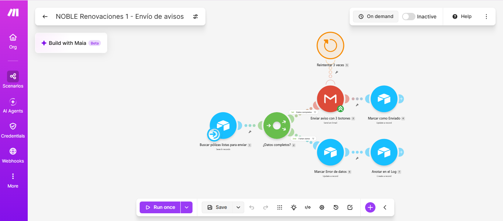
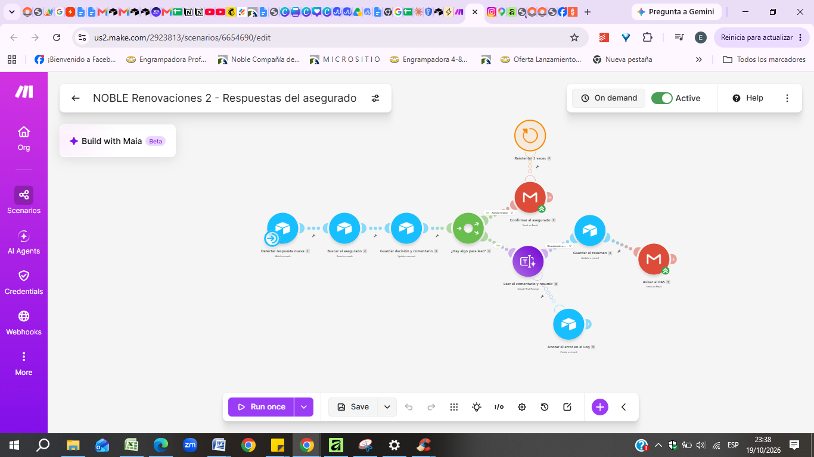
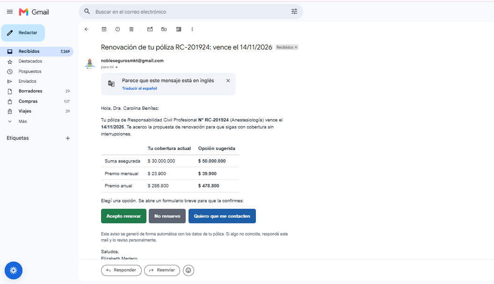
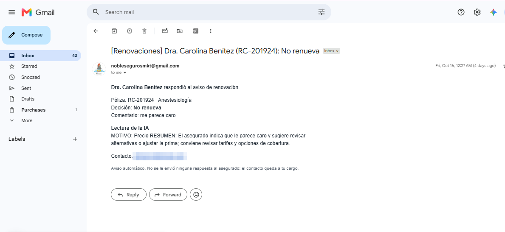
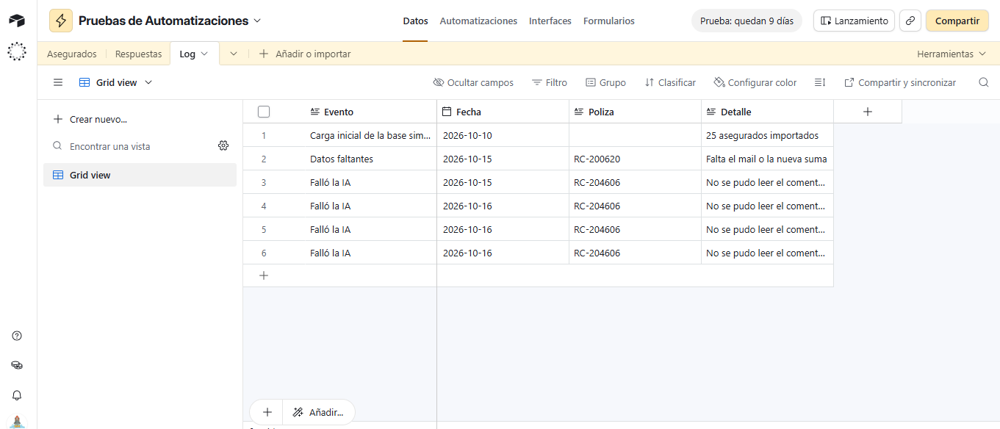
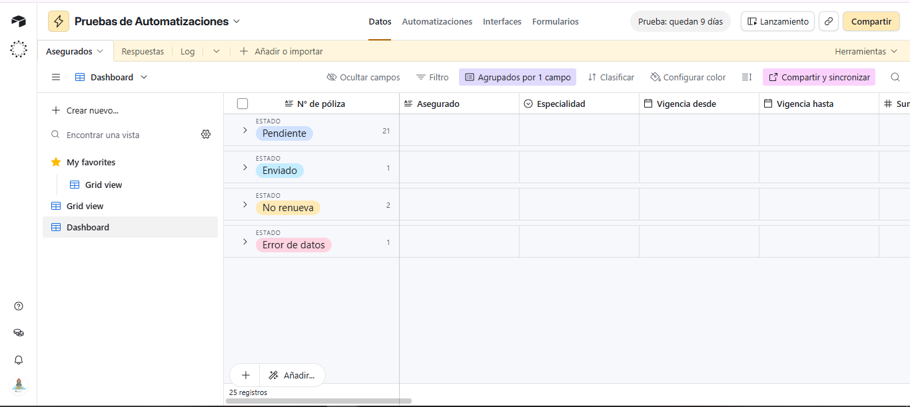

# Renovaciones automáticas para productores de seguros

**Entrega final · IA Automation · Coderhouse** — Elizabeth Medero

Ecosistema que reemplaza el envío manual de renovaciones de pólizas de Responsabilidad Civil Profesional. El productor asesor de seguros (PAS) aprueba qué pólizas salen, Make envía a cada asegurado un aviso con tres botones (renuevo, no renuevo, quiero que me contacten), el asegurado confirma en un formulario, Airtable registra la decisión y la IA le resume al PAS los casos que necesitan su atención.

## Stack

| Categoría | Herramienta |
|---|---|
| Orquestador | Make (2 escenarios) |
| Base de datos | Airtable (Asegurados, Respuestas, Log + formulario) |
| Procesamiento IA | Make AI Toolkit · Simple Text Prompt (modelo chico) |
| Canal de salida | Gmail (OAuth con aplicación propia en Google Cloud) |

## Cómo funciona

1. El PAS revisa la póliza en Airtable y la pasa a **Listo para enviar** (validación humana).
2. **Escenario 1** envía el aviso con la cobertura actual, la opción sugerida y los tres botones. Si faltan datos, no envía y lo registra en el Log.
3. El asegurado toca un botón y confirma en el formulario (puede dejar un comentario).
4. **Escenario 2** guarda la decisión en Airtable, confirma por mail a quien acepta y, si no acepta o comenta algo, la IA resume el pedido y avisa al PAS.
5. El PAS exporta la vista **Acepta renovar** y la envía a la compañía.

## Contenido del repositorio

| Archivo | Qué es |
|---|---|
| `Documentacion_tecnica_Renovaciones_NOBLE.pdf` | Diagrama de arquitectura, manual de datos y esquemas JSON, matriz de costos, seguridad y resiliencia, dashboard |
| `Escenario_1_Envio_de_avisos.blueprint.json` | Blueprint exportado de Make (envío de avisos) |
| `Escenario_2_Respuestas.blueprint.json` | Blueprint exportado de Make (respuestas del asegurado + IA) |
| Archivos `.png` | Capturas de evidencia (ver abajo) |

## Enlaces

- Base de datos (modo lectura): https://airtable.com/appgV5UYjCCXHAEqR/shrybXxZNtK1bG6TJ
- Dashboard de control: https://airtable.com/appgV5UYjCCXHAEqR/shrDjsSyl0ouss2Ge
- Video demo: https://www.loom.com/share/e57d6c9a79b2466a8893c8274b6e9f13

## Pruebas realizadas

| Prueba | Resultado |
|---|---|
| Envío de 3 avisos + 1 póliza sin mail | 3 mails con botones; 3 pólizas en Enviado; 1 en Error de datos con su registro en el Log |
| Respuesta "Acepta renovar" con comentario | Confirmación al asegurado; la IA falló y la ruta de error lo registró en el Log |
| Respuesta "No renueva" con comentario | Sin confirmación; resumen de la IA guardado y aviso al PAS |

Los datos de los 25 asegurados son simulados.

## Capturas

**Escenario 1 · Envío de avisos (Make)**

**Escenario 2 · Respuestas del asegurado (Make)**

**Aviso que recibe el asegurado**

**Aviso al PAS con la lectura de la IA**

**Log de errores (camino infeliz)**

**Dashboard de control**

